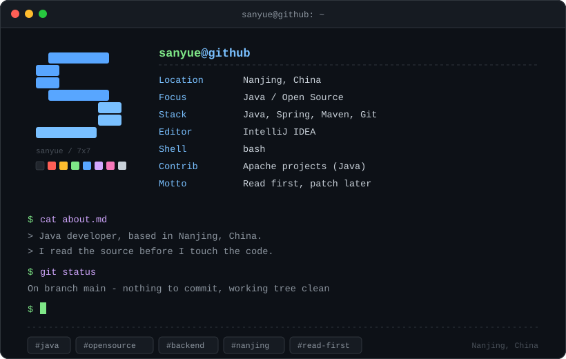

  <picture>
    <source media="(prefers-color-scheme: dark)" srcset="https://readme-typing-svg.demolab.com?font=JetBrains+Mono&weight=600&size=24&pause=1200&color=7EE787&center=true&vCenter=true&width=700&lines=Hi%2C+I%27m+sanyue;Java+Developer+%40+Nanjing%2C+China;Open+Source+Contributor;Read+first%2C+patch+later" />
    
  </picture>

  

<b>sanyue</b> · Java / Open Source · 中国南京

---

### About
- Java 开发，关注序列化、基础库与工具链
- 参与 Apache 开源项目的 Java 模块
- 先读源码，再谈改动

### Stack
`Java` `Spring` `Maven` `Git` `Linux` `IntelliJ IDEA`

---

<i>Read first, patch later.</i>

